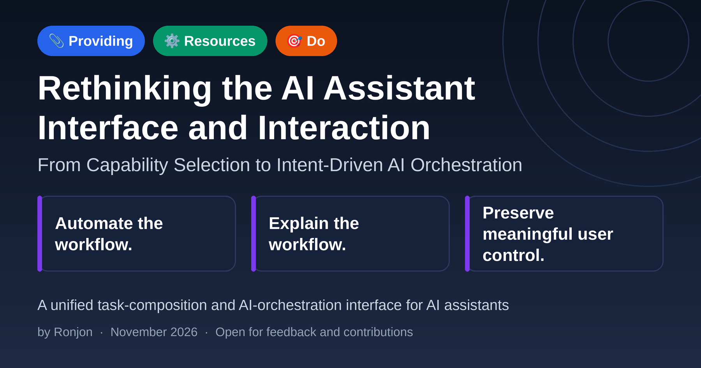
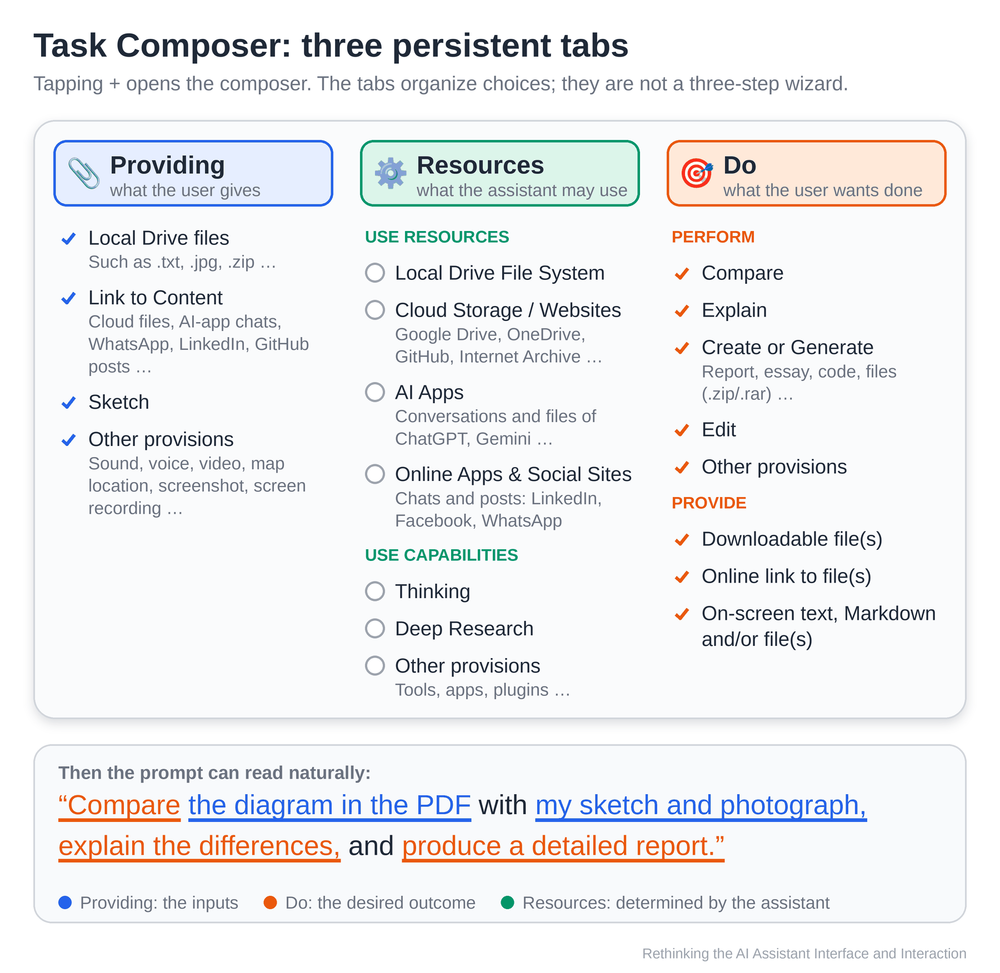
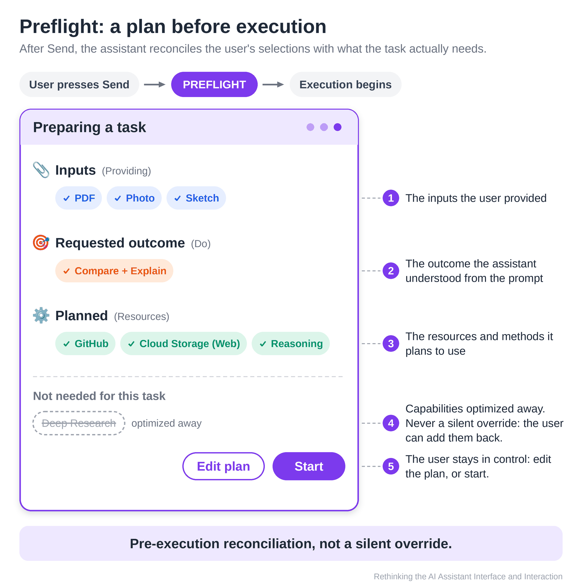
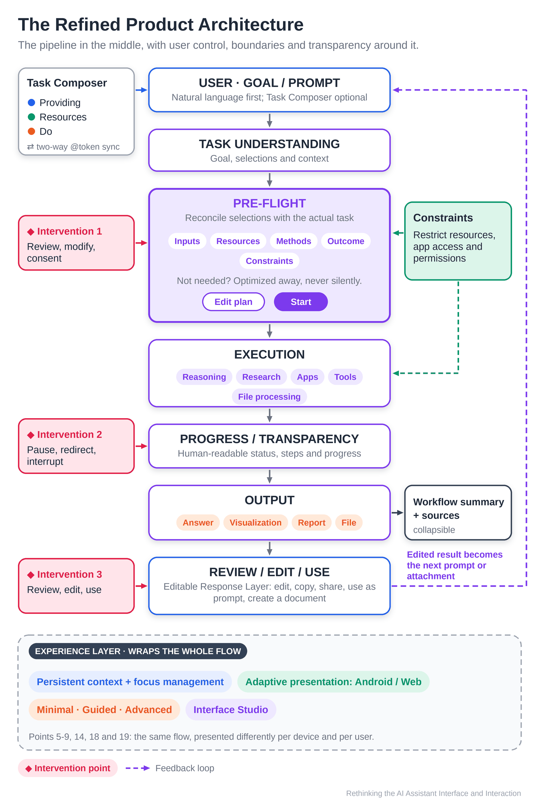

# Rethinking the AI Assistant Interface and Interaction

### From Capability Selection to Intent-Driven AI Orchestration

**A unified task-composition and AI-orchestration interface for AI assistants.**

> **Automate the workflow. Explain the workflow. Preserve meaningful user control.**

📄 **[Read the PDF](rethinking-the-ai-assistant-interface.pdf)**  ·  📖 **[Read it online](docs/rethinking-the-ai-assistant-interface.md)**  ·  💬 **[Give feedback](../../issues)**

## The idea in one minute

This proposal redesigns the **+** menu of AI assistants around intent rather than tools. Instead of asking users to choose the machinery, it lets them describe the outcome. The assistant determines the route, explains it in plain terms, respects the user’s constraints, and offers a chance to intervene where it matters.

- **Three persistent tabs** behind **+**: *Providing* (what the user gives), *Resources* (what the assistant may use) and *Do* (what the user wants done).
- **Preflight**: a short, editable plan shown after Send and before substantial execution.
- **Persistent context and focus management**, an **Editable Response Layer**, and an **Interface Studio** that the user can rearrange and reset at any time.

## The five features

1. **Three-Layer Task Composer.** Providing → Resources → Do (Desired Outcome).
2. **Preflight Orchestration.** After Send but before meaningful execution, the assistant reconciles user selections with the actual task requirements.
3. **Persistent Context + Focus Management.** Sticky parent and category headers, breadcrumbs, adaptive menus, and Android/Web-specific focus behavior.
4. **Editable Response Layer.** Every generated response can be edited before copying, sharing, quoting or reusing its content.
5. **Interface Studio.** Users can customize the presentation and arrangement of the assistant’s available capabilities and restore the default interface at any time.

## Key principles

- **Natural language first. Structured configuration second.**
- **Advanced options should be available without becoming prerequisites.**
- **Same information architecture, different spatial implementation.**
- **Context should remain visible while the user investigates it.**
- **AI-generated content is a draft that the user can refine before reuse.**
- **The user specifies the destination; the system determines the route.**

## A closer look

*Figure 1. The Task Composer behind the + button: three persistent tabs, and how a natural prompt maps onto them.*

*Figure 3. Preflight: the plan the assistant shows after Send and before execution.*

*Figure 20. The refined product architecture.*

## What is in this repository

| Path | What it is |
|---|---|
| `rethinking-the-ai-assistant-interface.pdf` | The complete document (PDF, 30 pages) |
| `docs/rethinking-the-ai-assistant-interface.md` | The same document as Markdown, with all figures |
| `images/` | The cover and 24 figures (PNG) |
| `CONTRIBUTING.md` | How to give feedback and contribute |
| `CITATION.cff` | How to cite this work |
| `LICENSE` | License (CC BY 4.0) |

## Contributing

Feedback, counter-examples, prototypes, corrections and translations are welcome. See [CONTRIBUTING.md](CONTRIBUTING.md). Open an [issue](../../issues) or start a [discussion](../../discussions).

## How to cite

Rashedul Haque Ronjon (2026). *Rethinking the AI Assistant Interface and Interaction: From Capability Selection to Intent-Driven AI Orchestration*. GitHub repository. See [CITATION.cff](CITATION.cff).

## License

Text and figures are licensed under CC BY 4.0. See [LICENSE](LICENSE).

## About

**Authorship.** Concept, structure and direction: Rashedul Haque Ronjon.

**Origin.** The ideas grew out of hands-on use of AI assistant apps on Android and the web, and out of an iterative prompting dialogue with ChatGPT in October 2026, in which the author set out the concepts and corrected the drafts (see References). The examples in points 2, 5, 11, 13 and 16 come from observing ChatGPT’s Android and web apps. The proposal is meant to apply to any assistant.

**AI assistance.** ChatGPT was used as a drafting aid in that dialogue. Claude (Anthropic) assisted with generalizing the text, drawing the figures and assembling this document and repository. The author directed the work and is responsible for its content.

**Independence.** This is an independent community proposal. It is not affiliated with or endorsed by OpenAI, Anthropic or any other company, and product names are trademarks of their owners. The figures are schematic wireframes drawn for this proposal; they illustrate concepts and are not official screenshots. Emoji in the figures are Noto Emoji by Google (Apache License 2.0).
