# Rethinking the AI Assistant Interface and Interaction

### From Capability Selection to Intent-Driven AI Orchestration

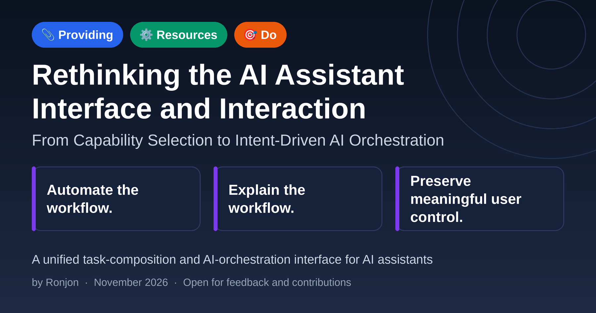

**A unified task-composition and AI-orchestration interface for AI assistants.**

> **Automate the workflow. Explain the workflow. Preserve meaningful user control.**

[Back to the repository README](../README.md)  ·  [PDF version](../Rethinking-AI-Assistant-Interface.pdf)

## Contents

- [Summary](#summary)
- [Scope and terminology](#scope-and-terminology)
- [1. A Better + Menu: Three Persistent Tabs](#1-a-better--menu-three-persistent-tabs)
- [2. Multiple Selection With Better State Management](#2-multiple-selection-with-better-state-management)
- [3. Introduce a “Preflight” Stage Immediately After Send](#3-introduce-a-preflight-stage-immediately-after-send)
- [4. “What Do I Want Done?” May Have Optional Submenus](#4-what-do-i-want-done-may-have-optional-submenus)
- [5. The “Plugins” Navigation Problem: A Persistent Parent-Context Indicator](#5-the-plugins-navigation-problem-a-persistent-parent-context-indicator)
- [6. Add Breadcrumbs for Deeper Navigation](#6-add-breadcrumbs-for-deeper-navigation)
- [7. Navigation Panel and Prompt: A “Focus Mode” Pattern](#7-navigation-panel-and-prompt-a-focus-mode-pattern)
- [8. Desktop and Web Should Use Split Focus Rather Than the Mobile Pattern](#8-desktop-and-web-should-use-split-focus-rather-than-the-mobile-pattern)
- [9. Adaptive Presentation Should Be a Formal Design Rule](#9-adaptive-presentation-should-be-a-formal-design-rule)
- [10. Status Bar and Progressive Workflow](#10-status-bar-and-progressive-workflow)
- [11. A Collapsible “Workflow Summary”](#11-a-collapsible-workflow-summary)
- [12. A User-Control “Intervention Point”](#12-a-user-control-intervention-point)
- [13. A User Should Be Able to Restrict the AI](#13-a-user-should-be-able-to-restrict-the-ai)
- [14. A “Minimal / Guided / Advanced” Interaction Preference](#14-a-minimal--guided--advanced-interaction-preference)
- [15. Response Editing: The Editable Response Layer](#15-response-editing-the-editable-response-layer)
- [16. Citation Links: Contextual Source Inspection](#16-citation-links-contextual-source-inspection)
- [17. A Unified Example](#17-a-unified-example)
- [18. Interface Studio](#18-interface-studio)
- [19. The Proposed Web and Android Architecture Can Now Be Unified](#19-the-proposed-web-and-android-architecture-can-now-be-unified)
- [20. The Refined Product Architecture](#20-the-refined-product-architecture)
- [21. The Five Features of the Proposal](#21-the-five-features-of-the-proposal)
- [22. The Core Product Proposal](#22-the-core-product-proposal)
- [23. Closing Statement](#23-closing-statement)
- [References](#references)
- [About this document](#about-this-document)

## Summary

This proposal redesigns the **+** menu of AI assistants around intent rather than tools. Instead of asking users to choose the machinery, it lets them describe the outcome. The assistant determines the route, explains it in plain terms, respects the user’s constraints, and offers a chance to intervene where it matters.

- **Three persistent tabs** behind **+**: *Providing* (what the user gives), *Resources* (what the assistant may use) and *Do* (what the user wants done).
- **Preflight**: a short, editable plan shown after Send and before substantial execution.
- **Persistent context and focus management**, an **Editable Response Layer**, and an **Interface Studio** that the user can rearrange and reset at any time.

> **Automate the workflow. Explain the workflow. Preserve meaningful user control.**

## Scope and terminology

This document is about conversational AI assistants on mobile, web and desktop, and it is not tied to any single product. In it, *the assistant* means any such assistant, *the composer* is the prompt area together with its **+** (attach and tools) menu, and *the user* is the person talking to the assistant. The terms *cloud storage* and *websites* (or *sites*) are used interchangeably for the online places where files and content live, such as Google Drive, OneDrive, GitHub or the Internet Archive.

Some examples come from hands-on observation of current assistant apps on Android and the web in October 2026. They illustrate general patterns. See *About this document* at the end for the origin of the ideas.

## 1. A Better + Menu: Three Persistent Tabs

I recommend making the idea more concrete by proposing three primary tabs behind the **+** button. Tapping **+** opens the **Task Composer**.

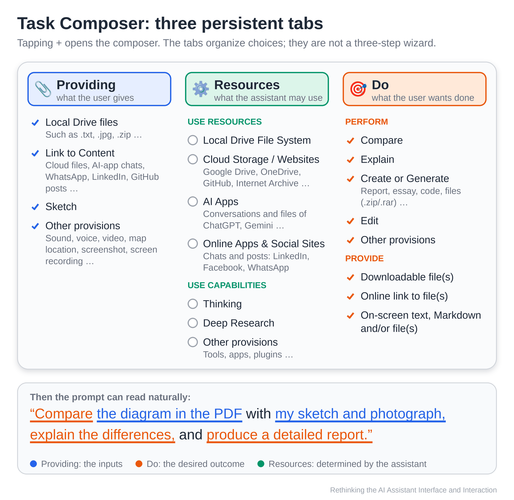

*Figure 1. The Task Composer behind the + button: three persistent tabs, and how a natural prompt maps onto them.*

The tabs are not intended to force the user through a three-step wizard. They are simply three ways of organizing the available choices, and the user can jump between them at any time. For example:

### Providing: what the user gives

- Local drive files, such as .txt, .jpg, .zip and so on.
- **Link to Content**: links to cloud-storage files; AI-app conversations and files; app conversations and files (for example a WhatsApp group, contact or chats); online app or site content, posts and comments (for example LinkedIn, Facebook, GitHub).
- Sketch.
- Other provisions, such as sound, voice, video, map location, screenshot, screen recording and so on.

### Resources: what the assistant may use

**Use Resources** (submenu)

- Local drive file system.
- Cloud storage and websites (used interchangeably), such as Google Drive, OneDrive, GitHub, Internet Archive and so on.
- Resources such as conversations and files of AI apps like ChatGPT, Gemini and so on.
- Online app or social-site resources, such as chats, posts and comments of apps and sites like LinkedIn, Facebook, WhatsApp and so on.

**Use Capabilities** (submenu)

- Thinking.
- Deep Research.
- Other provisions (tools, apps and/or plugins and so on).

### Do: what the user wants done

**Perform** (submenu)

- Compare.
- Explain.
- Create or Generate (report, post, email, essay, journal, article, code, a collection of files as .zip/.rar, and so on).
- Edit.
- Other provisions.

**Provide** (submenu)

- Downloadable file(s).
- Online link to file(s).
- On-screen text, Markdown and/or file(s).

Then the prompt can read naturally:

> “Compare the diagram in the PDF with my sketch and photograph, explain the differences, and produce a detailed report.”

This is much closer to how people naturally think.

## 2. Multiple Selection With Better State Management

The multiple-selection behavior of a current assistant menu gives a particularly useful interaction model. I would formalize it as follows. When an item is selected, it becomes:

- checked;
- visibly selected;
- inactive (disabled) in the selection list;
- represented as a chip or token in the composer.

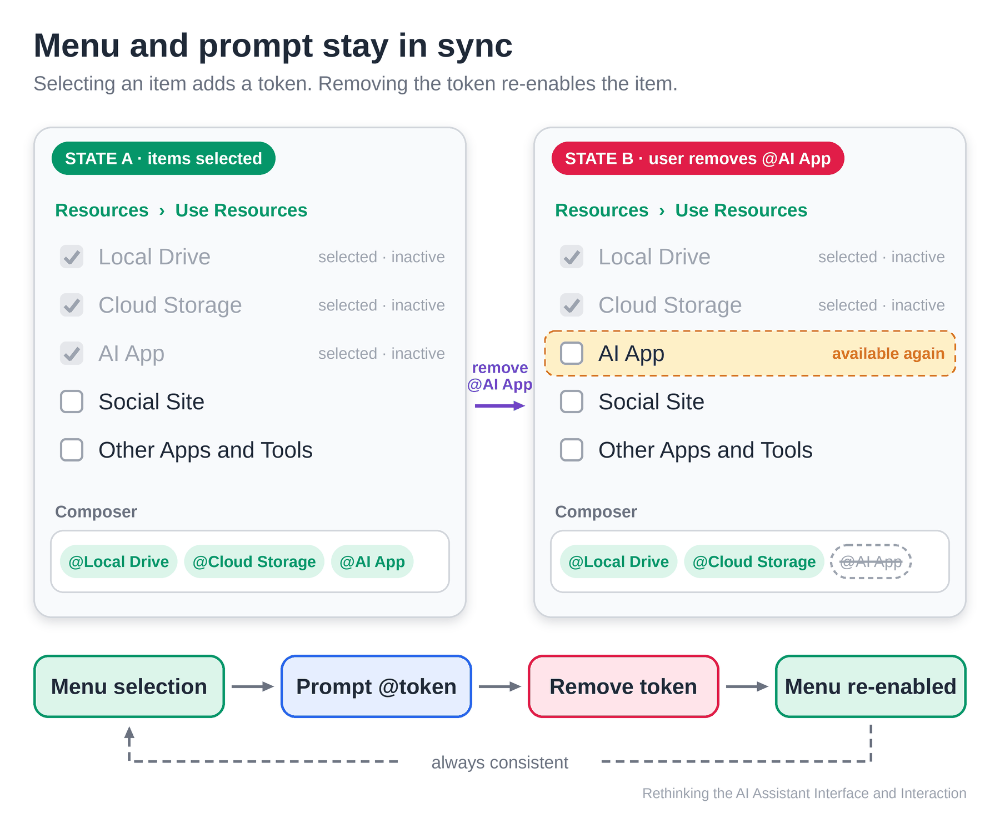

*Figure 2. Two-way synchronization between the menu and the prompt tokens.*

For example, under **Resources → Use Resources**, the user selects Local Drive, Cloud Storage and AI App, while Social Site and Other Apps and Tools stay unchecked. The composer then shows `@Local Drive` `@Cloud Storage` `@AI App`.

When the user removes `@AI App`, the state reverses: AI App is unchecked and becomes available for selection again. This creates a clear two-way synchronization:

> menu selection → prompt `@token` → remove token → menu re-enabled

That is an important usability detail and worth making an explicit feature of the proposal.

## 3. Introduce a “Preflight” Stage Immediately After Send

After the user presses Send, the assistant can determine what it actually needs before execution. I think this should become a named UX concept: **Preflight**.

The user presses Send. Before substantial execution begins, the assistant shows a short, readable plan:

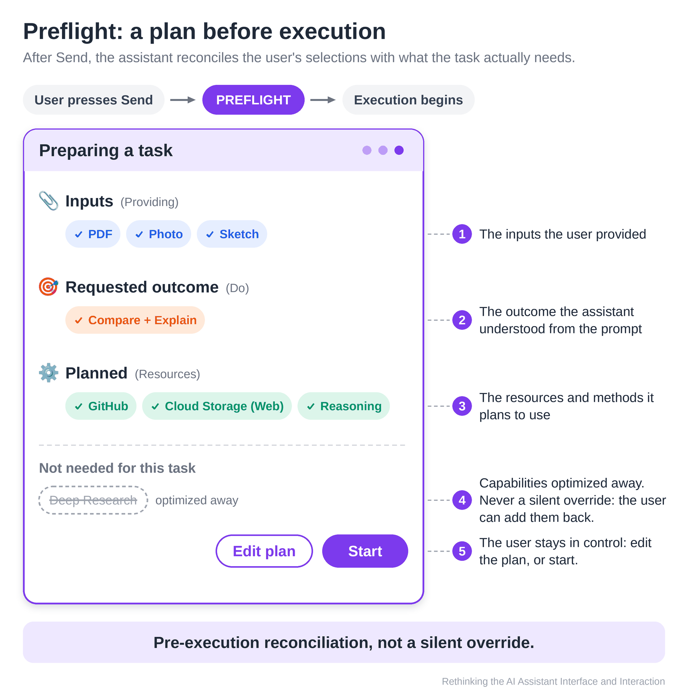

*Figure 3. Preflight: the plan the assistant shows after Send and before execution.*

This solves several problems at once. The assistant can offer to remove or bypass Deep Research, and, for ordinary processing, unnecessary capabilities can be optimized away.

The important distinction is that the system is not silently overriding the user. It is performing a **pre-execution reconciliation**.

## 4. “What Do I Want Done?” May Have Optional Submenus

The important design principle is:

> **Advanced options should be available without becoming prerequisites.**

For example:

- **Do → Perform → Create → Report** (or Essay, Journal, Article, Code, a collection of files as .zip/.rar; it could be anything);
- **Do → Provide → Downloadable File/s →** (Visualization → Chart) & (Output → Static) & (Format → PDF) & (Report style → Academic).

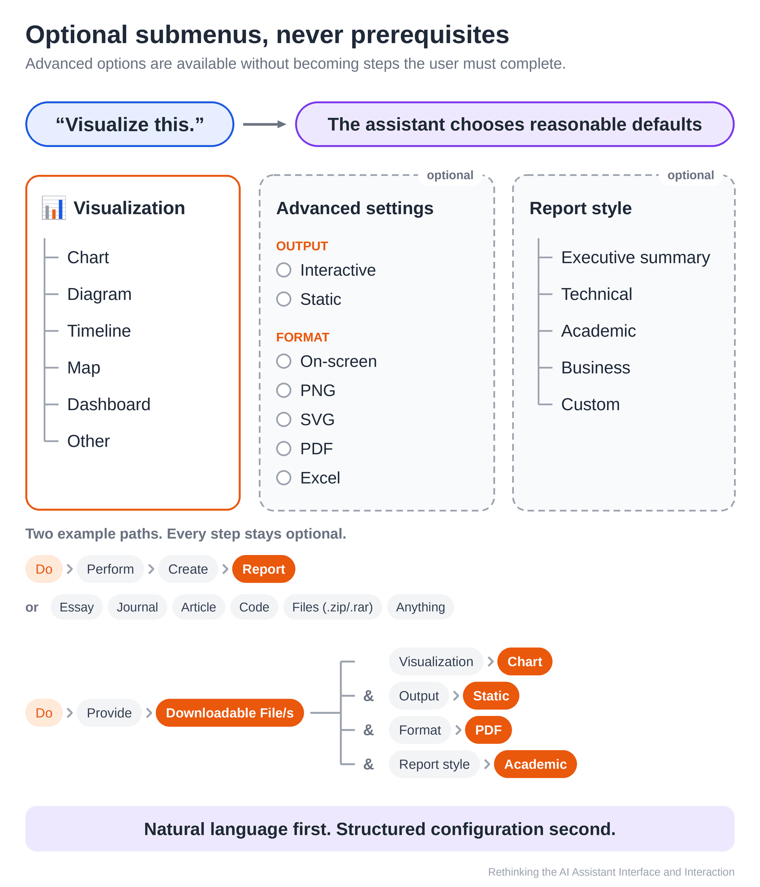

*Figure 4. Optional submenus and two example paths: advanced options without prerequisites.*

Under Visualization the choices could be Chart, Diagram, Timeline, Map, Dashboard and Other. Then come optional advanced settings:

- **Output**: Interactive or Static.
- **Format**: On-screen, PNG, SVG, PDF or Excel.

The user does not need to configure any of these to say “Visualize this.” The assistant can choose reasonable defaults. There can also be an optional **Report style**: Executive summary, Technical, Academic, Business or Custom.

Again:

> **Natural language first. Structured configuration second.**

That should become one of the proposal’s explicit design principles.

## 5. The “Plugins” Navigation Problem: A Persistent Parent-Context Indicator

In one current assistant app, the “Plugins” submenu shows a classic navigation problem: the “Plugins” label can scroll out of view. The list below it (Create image, Sketch, Thinking, Deep research, Study, GitHub, OpenAI Platform, Visualize) then has no visible parent, and the user can forget: *“What menu am I currently inside?”*

The proposed solution is a **Persistent Parent-Context Indicator**. The parent label stays anchored (sticky) at the top, even after scrolling:

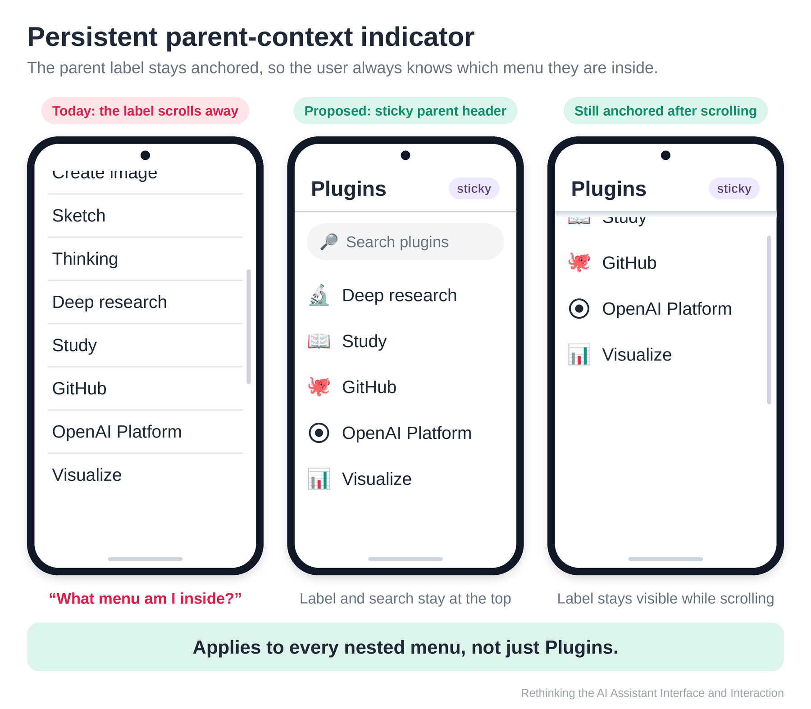

*Figure 5. A persistent parent-context indicator keeps the menu name visible while scrolling (schematic).*

This can be generalized to every nested menu, not just Plugins.

## 6. Add Breadcrumbs for Deeper Navigation

For more complicated menus, a trail such as **+ → Providing → Resources → Do** can be shown at the top as **← Providing / Resources / Do**. This solves the same orientation problem at greater depth.

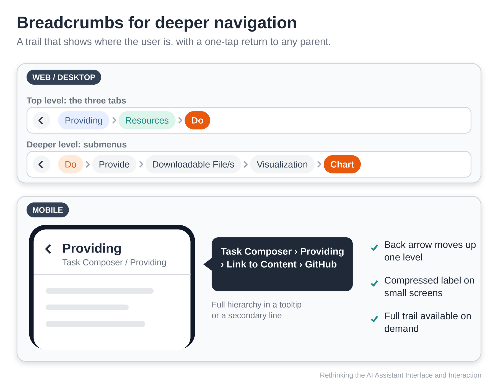

*Figure 6. Breadcrumbs on web and desktop, and the compressed form on mobile.*

On mobile, the breadcrumb can be compressed to **← Providing**, while the detailed hierarchy appears in a tooltip or a secondary line.

## 7. Navigation Panel and Prompt: A “Focus Mode” Pattern

When the Navigation Panel (Providing, Resources, Do) is active, the user generally isn’t entering text into the prompt at the same time. Instead of letting two competing surfaces overlap, I would formally propose **Interaction Focus Switching**.

On mobile, when the menu is active, the prompt is not destroyed or hidden. It becomes a persistent **draft indicator**:

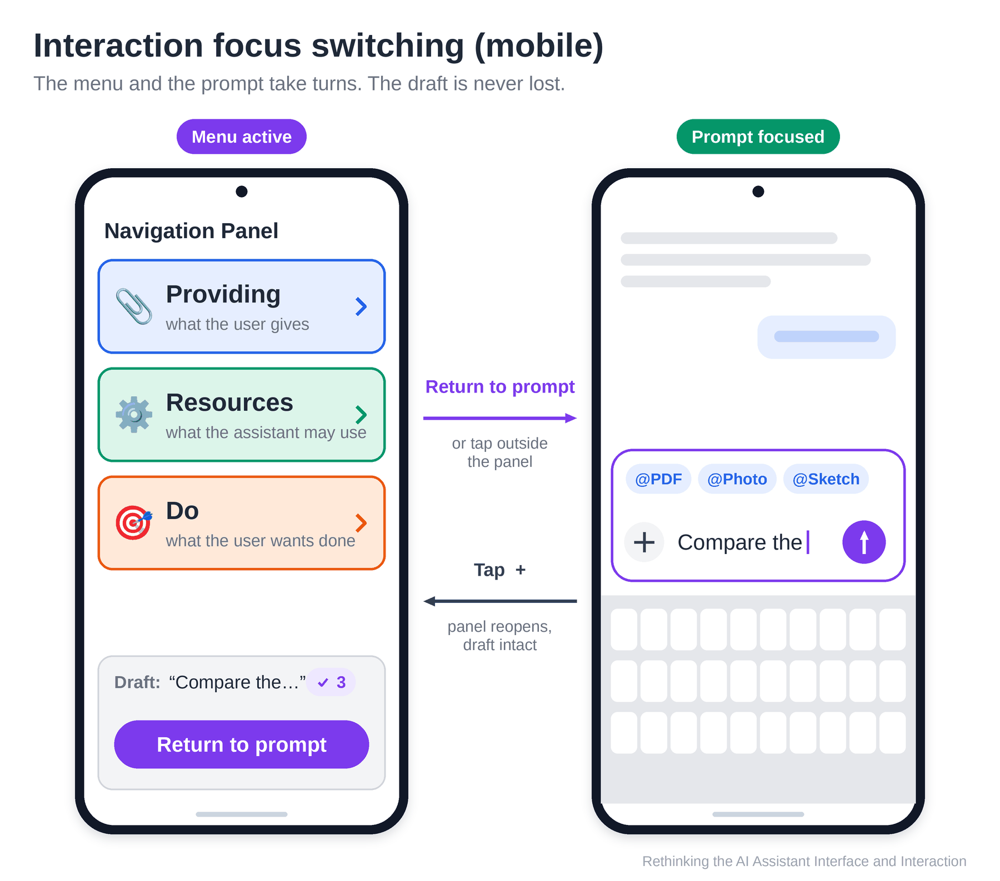

*Figure 7. Interaction focus switching on mobile: the menu and the prompt take turns.*

Pressing **Return to prompt** (or tapping outside the Navigation Panel) collapses the panel and returns focus to the prompt.

## 8. Desktop and Web Should Use Split Focus Rather Than the Mobile Pattern

This is where the concept can intelligently diverge between platforms. On web and desktop there is much more screen space, so the user can configure resources and still see the prompt:

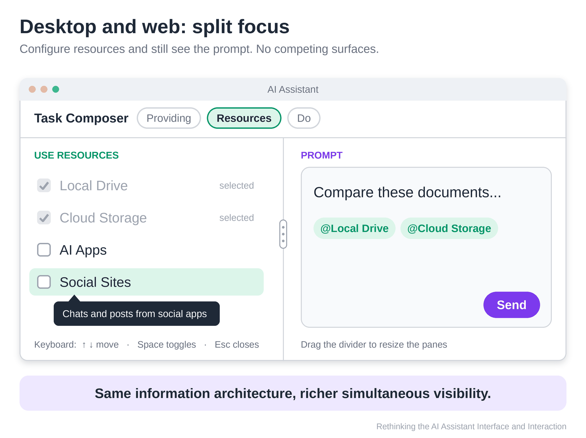

*Figure 8. Split focus on desktop and web: configure resources and still see the prompt.*

On mobile, the same interface becomes a full-screen menu and a full-screen prompt, with a small persistent draft and selection bar. That is much more appropriate than squeezing both into the same small viewport.

## 9. Adaptive Presentation Should Be a Formal Design Rule

The proposal should state it as a rule.

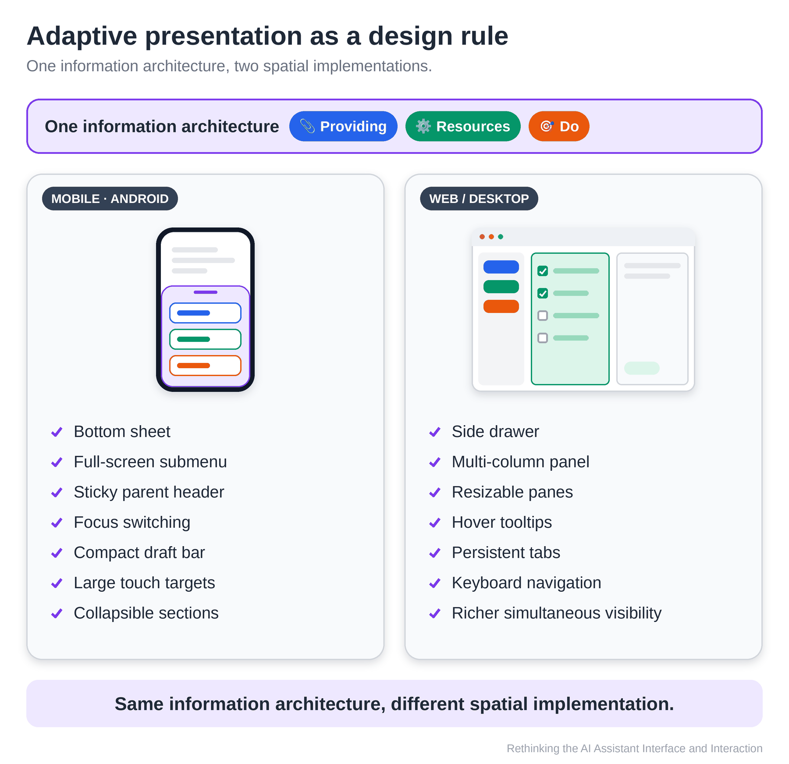

*Figure 9. Adaptive presentation: one information architecture, two spatial implementations.*

**Mobile (Android)** should use:

- a bottom sheet;
- a full-screen submenu;
- a sticky parent header;
- focus switching;
- a compact draft bar;
- large touch targets;
- collapsible sections.

**Web and desktop** should use:

- a side drawer;
- a multi-column panel;
- resizable panes;
- hover tooltips;
- persistent tabs;
- keyboard navigation;
- richer simultaneous visibility.

> **Same information architecture, different spatial implementation.**

That is an important distinction for the proposal.

## 10. Status Bar and Progressive Workflow

The interface should also show status information. For a research task it could read: *Researching multiple sources, 72%. Current step 3 / 4: Comparing findings.*

For an ordinary task it could show the steps as they happen: Reading uploaded PDF → Analyzing diagram → Comparing with photograph → Creating visualization.

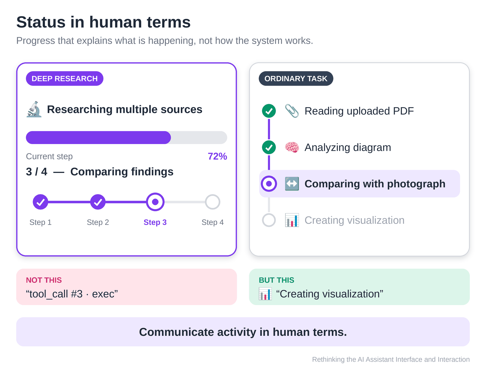

*Figure 10. Status in human terms, for a research task and for an ordinary task.*

The interface should communicate activity in human terms, not merely system terminology.

## 11. A Collapsible “Workflow Summary”

Once the work is finished, a collapsible summary shows what was done, what was used, and what was produced:

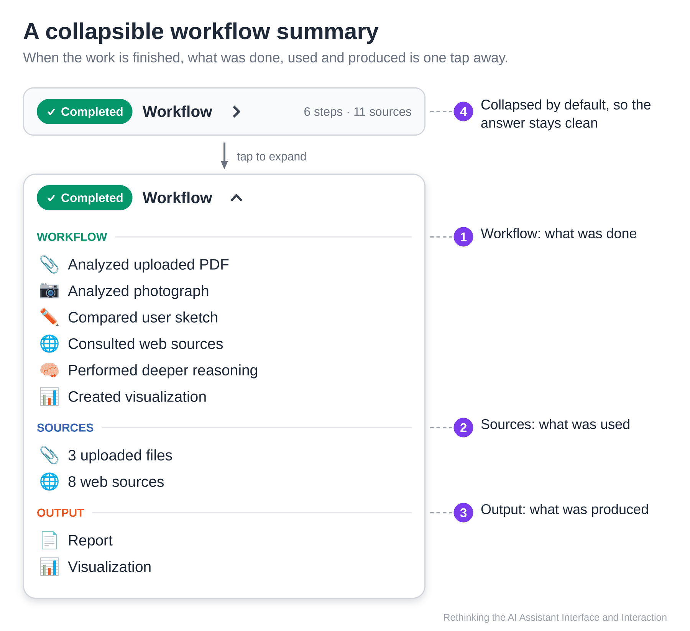

*Figure 11. A collapsible workflow summary, collapsed and expanded.*

This builds directly on the transparency idea at the heart of this proposal: explain the workflow. Research-style features in current assistants already provide a model in this direction. For example, in ChatGPT’s Deep Research, users can edit the research plan before it starts, follow progress, interrupt the research, and receive a structured report with citations ([Deep research in ChatGPT, OpenAI Help Center](https://help.openai.com/en/articles/10500283)).

## 12. A User-Control “Intervention Point”

The workflow should therefore include three points where the user can step in:

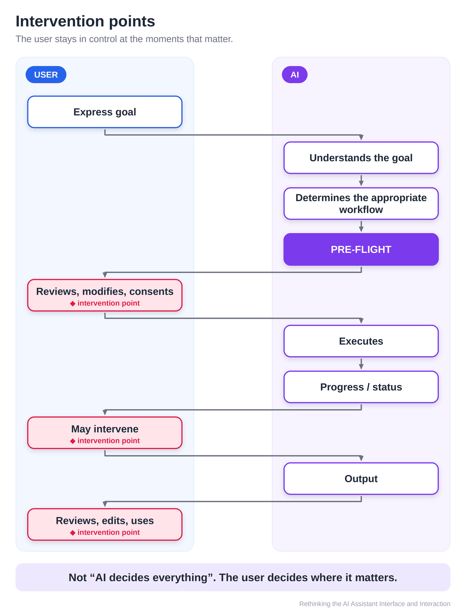

*Figure 12. The workflow with three user intervention points.*

<details>
<summary>Text version of the workflow</summary>

```text
USER
  -> Express goal
  -> AI understands goal
  -> AI determines appropriate workflow
  -> PRE-FLIGHT
  -> User may review / modify / consent        (intervention point)
  -> AI executes
  -> PROGRESS / STATUS
  -> User may intervene                        (intervention point)
  -> OUTPUT
  -> User reviews / edits / uses               (intervention point)
```

</details>

This is better than a simplistic “AI decides everything.” The user remains in control at the points that matter.

## 13. A User Should Be Able to Restrict the AI

The system should support constraints in two ways: structured, through the Resources tab (for example Local Drive and Cloud Storage on, AI Apps and Social Sites off), or in natural language, such as *“Only use the uploaded documents. Do not search the Cloud Storage.”* The AI then works within that boundary.

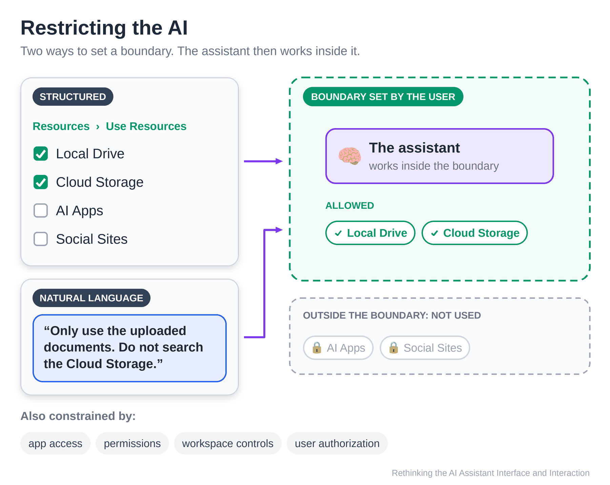

*Figure 13. Restricting the AI with a structured boundary or in natural language.*

This becomes particularly important where external apps, private information or actions are involved. Assistant platforms already document that app access, permissions, workspace controls and user authorization can constrain what an assistant can do (for example, OpenAI’s documentation for ChatGPT: [Managing app permissions in ChatGPT](https://help.openai.com/en/articles/20001495) and [Admin controls for apps in ChatGPT](https://help.openai.com/en/articles/11509118)). A visible, user-set boundary complements those controls.

## 14. A “Minimal / Guided / Advanced” Interaction Preference

This fits the future personalization idea as well as the immediate proposal. The user mostly communicates naturally, and chooses how much interface they want:

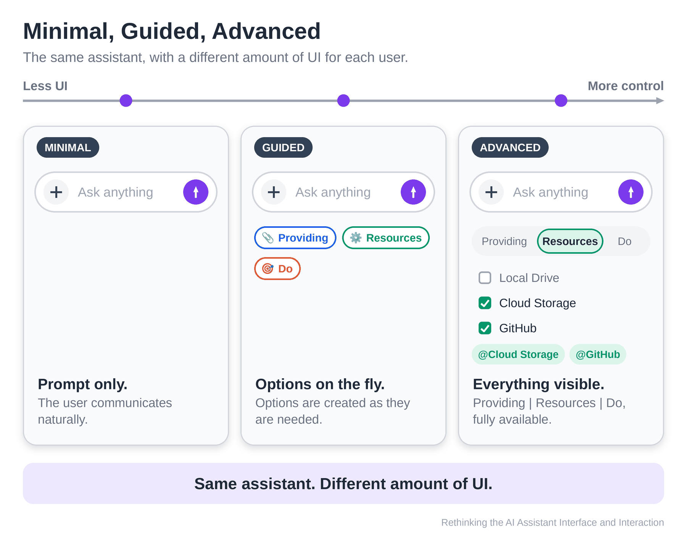

*Figure 14a. Minimal, Guided and Advanced interaction: the same assistant with different amounts of UI.*

- **Minimal**: the **+** button and the prompt.
- **Guided**: options are created on the fly, with Providing, Resources and Do appearing as needed.
- **Advanced**: the full **Providing | Resources | Do** panel, with selections shown as tokens in the prompt.

In Advanced mode, for example, the user might choose a PDF and a photo (Providing), Google Drive and GitHub with Thinking (Resources), and Compare with a Word file as the result (Do). The prompt then carries `@PDF` `@Photo` `@Google Drive` `@GitHub` `@Thinking` `@Compare` `@Word File`.

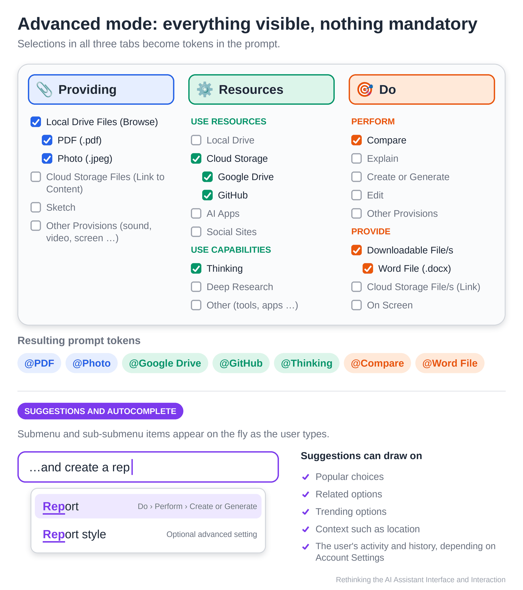

*Figure 14b. Advanced mode with selections in all three tabs, the resulting tokens, and suggestions with autocomplete.*

This prevents the redesign from assuming that every user wants the same amount of UI.

### Smart Suggestions and Autocomplete

In Guided and Advanced interaction, options, tools and submenu or sub-submenu items can be suggested and autocompleted on the fly while the user types, shown as underlined items. The same applies to the optional advanced settings such as Visualization, Format, Output and Report style.

Suggestions and autocomplete help users find options faster by predicting what they are looking for and showing relevant choices as they type. They can draw on popular choices, related options, trending options, context such as location, and the user’s own activity and history, depending on their Account Settings.

## 15. Response Editing: The Editable Response Layer

A user should be able to edit any response before copying or using any part of it. I recommend calling this the **Editable Response Layer**.

Every assistant response gets the actions 👍 👎 **Edit** · Copy · Share · ⋯. Selecting **Edit** turns the response into an editable version, and the original AI response remains preserved:

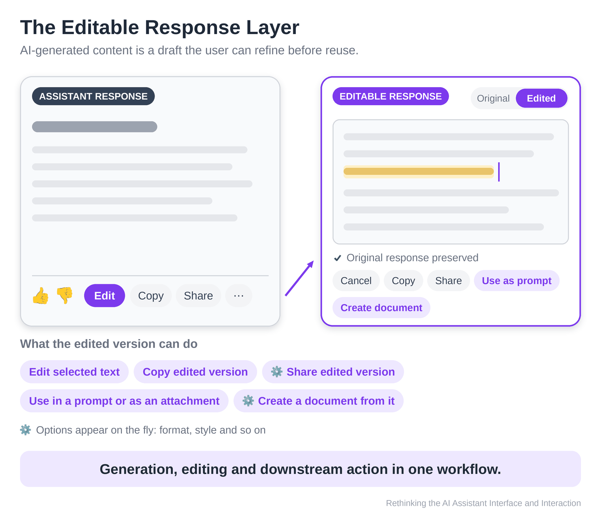

*Figure 15. The Editable Response Layer: edit before copying, sharing or reusing, with options on the fly.*

This could also support:

- editing selected text;
- copying the edited version;
- sharing the edited version (with options on the fly, like format and style);
- using the edited version in a prompt or as an attachment;
- creating a document from the edited version (with options on the fly, like format, style and so on).

That creates an important separation:

> **AI-generated content is a draft that the user can refine before reuse.**

For a product proposal, this is a particularly strong feature because it connects generation, editing and downstream action into one coherent workflow.

## 16. Citation Links: Contextual Source Inspection

The citation and source panel can serve as a model for contextual source inspection. Rather than forcing the user into a completely different page, a source could open in a panel or popover:

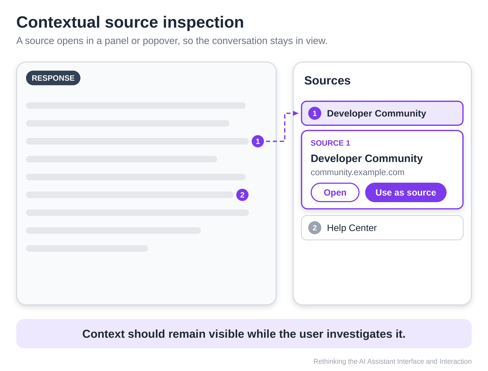

*Figure 16. Contextual source inspection in a panel, with the conversation still in view.*

This supports the larger principle:

> **Context should remain visible while the user investigates it.**

## 17. A Unified Example

Suppose the user says: *“Compare these three PDFs with my photograph, check whether the specifications are still current, look at my GitHub project, and create an Excel report with charts.”* The user does not need to understand the machinery.

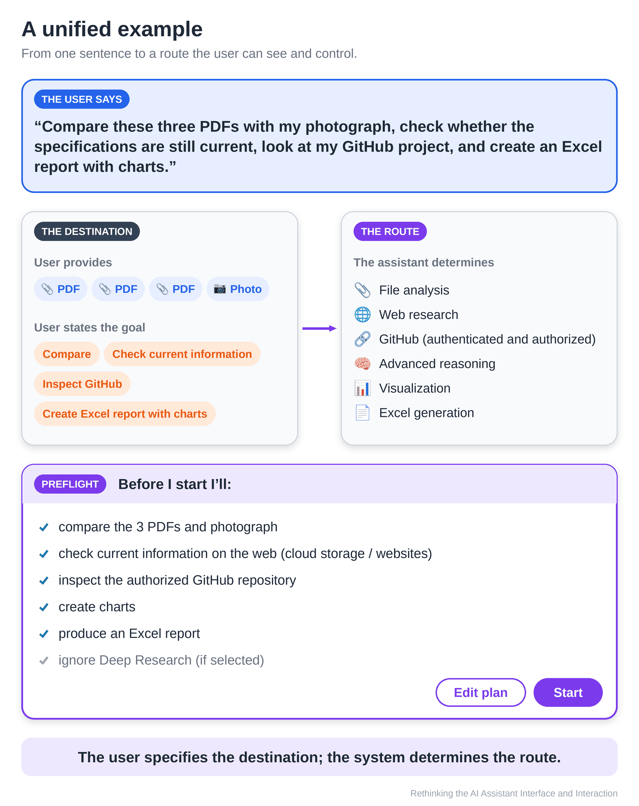

*Figure 17. A unified example, from one sentence to a Preflight plan.*

- **User provides:** three PDFs and a photograph.
- **User states the goal:** compare; check current information; inspect GitHub; create an Excel report with charts.
- **The assistant determines:** file analysis; web research; GitHub (authenticated and authorized); advanced reasoning; visualization; Excel generation.

Then comes Preflight: *“Before I start I’ll: compare the 3 PDFs and photograph; check current information on the web (cloud storage / websites); inspect the authorized GitHub repository; create charts; produce an Excel report; ignore Deep Research (if selected).”* The user can **Edit plan** or **Start**.

That is exactly the philosophy to be developed:

> **The user specifies the destination; the system determines the route.**

## 18. Interface Studio

Users can customize the presentation and arrangement of the assistant’s available capabilities and restore the default interface at any time.

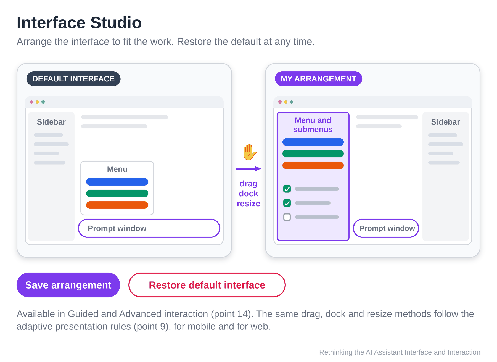

*Figure 18. Interface Studio: arrange the interface and restore the default at any time.*

In Guided and Advanced interaction (point 14), a user can set or arrange the interface, for example by dragging, setting and changing the positions of the sidebar, the prompt window, and the menu and submenu windows. The methods are the ones described in point 9 (adaptive presentation), chosen to suit the type of work, the user’s comfort and requirements. The user can also return the interface to its default mode whenever required.

## 19. The Proposed Web and Android Architecture Can Now Be Unified

The proposal should be: design a **cross-platform, intent-driven capability architecture**, with Android and Web using different spatial presentations of the same conceptual model.

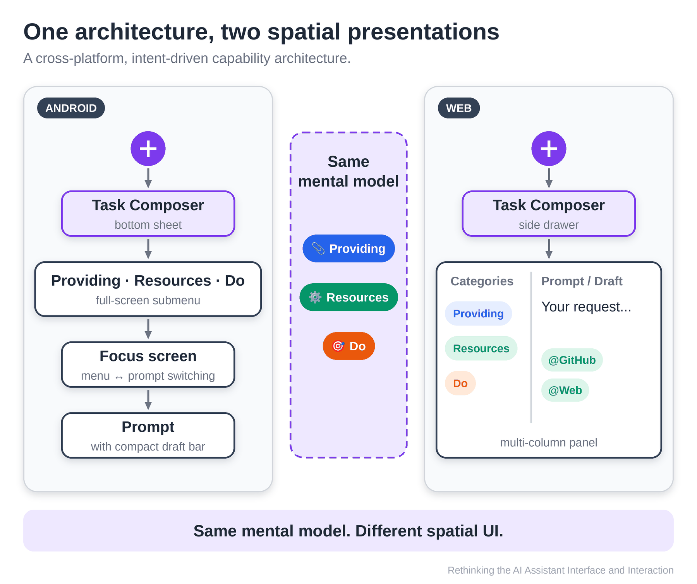

*Figure 19. One conceptual model, presented differently on Android and on the web.*

> **Same mental model. Different spatial UI.**

## 20. The Refined Product Architecture

The complete model is now:

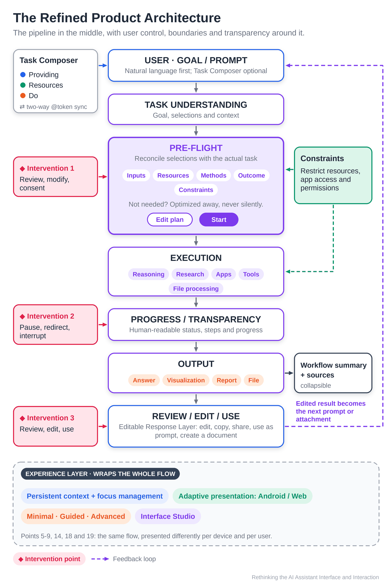

*Figure 20. The refined product architecture.*

The refined architecture shows the pipeline from goal to review, together with the layers around it that points 1 to 19 introduced:

- **A front door.** The optional Task Composer (Providing, Resources, Do) feeds the prompt through two-way-synced `@tokens` (points 1 and 2), alongside plain natural language.
- **Boundaries.** User constraints (point 13) apply to both Preflight and Execution.
- **Three intervention points.** The user can review, modify and consent at Preflight; intervene during Progress; and review, edit and use at the end (point 12).
- **A transparency record.** A collapsible Workflow Summary and Sources (points 11 and 16) accompany the output.
- **An editable end of the pipeline.** The Editable Response Layer (point 15) lets the user refine the result, and the edited version can feed the next prompt or attachment, which closes the loop.
- **An experience layer.** Persistent context and focus management (points 5 to 8), adaptive presentation (points 9 and 19), interaction modes (point 14) and the Interface Studio (point 18) wrap the whole flow.

<details>
<summary>Text version of the refined architecture</summary>

```text
USER
  |
  v
GOAL / PROMPT  <---------------- TASK COMPOSER (Providing | Resources | Do)
  |                                two-way sync with @tokens
  v
TASK UNDERSTANDING
  |
  v
PRE-FLIGHT  (Inputs, Resources, Methods, Outcome, Constraints)
  |   <-- INTERVENTION 1: user can review / modify / consent
  |   <-- CONSTRAINTS: user-set boundaries and permissions
  v
EXECUTION  (Reasoning, Research, Apps, Tools, File processing)
  |
  v
PROGRESS / TRANSPARENCY
  |   <-- INTERVENTION 2: user may intervene
  v
OUTPUT  (Answer, Visualization, Report, File)
  |   --> WORKFLOW SUMMARY + SOURCES (collapsible)
  v
REVIEW / EDIT / USE  (Editable Response Layer)
      <-- INTERVENTION 3: user reviews / edits / uses
      --> the edited result can become the next prompt or attachment (loop)

EXPERIENCE LAYER around the whole flow:
persistent context + focus management | adaptive presentation (Android / Web)
| Minimal / Guided / Advanced | Interface Studio
```

</details>

## 21. The Five Features of the Proposal

The proposal names five features:

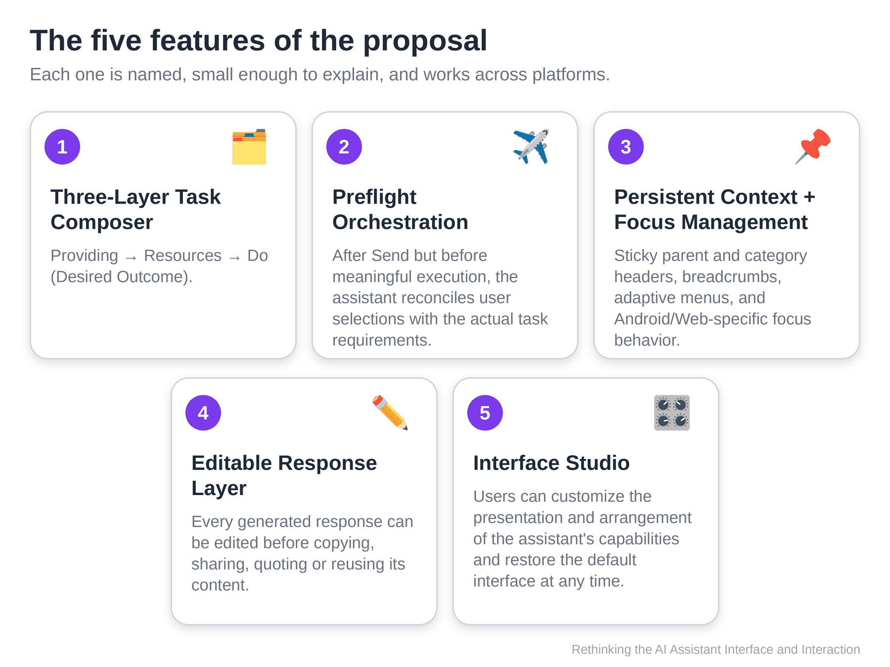

*Figure 21. The five features of the proposal.*

1. **Three-Layer Task Composer.** Providing → Resources → Do (Desired Outcome).
2. **Preflight Orchestration.** After Send but before meaningful execution, the assistant reconciles user selections with the actual task requirements.
3. **Persistent Context + Focus Management.** Sticky parent and category headers, breadcrumbs, adaptive menus, and Android/Web-specific focus behavior.
4. **Editable Response Layer.** Every generated response can be edited before copying, sharing, quoting or reusing its content.
5. **Interface Studio.** Users can customize the presentation and arrangement of the assistant’s available capabilities and restore the default interface at any time.

## 22. The Core Product Proposal

> **Redesigning the AI Assistant’s + Menu: From Capability Selection to Intent-Driven AI Orchestration**

A cross-platform interaction model that separates inputs, resources and outcomes while allowing the assistant to orchestrate the workflow automatically, with transparent progress and meaningful user control.

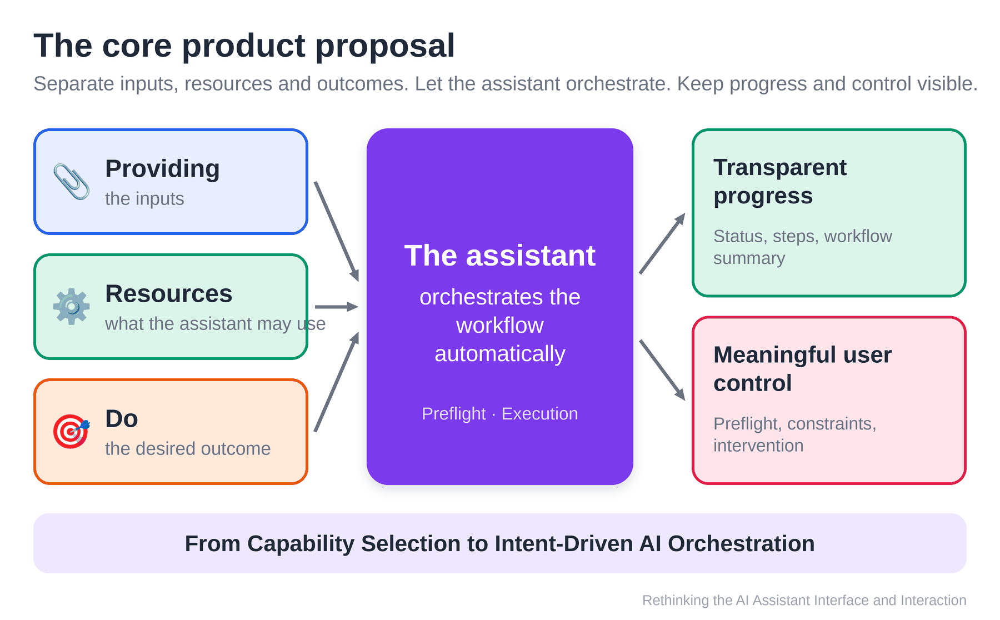

*Figure 22. The core product proposal.*

## 23. Closing Statement

> Today, AI products increasingly contain more capabilities, integrations, tools and workflows. The answer does not have to be giving the user more things to configure.
>
> Instead of asking users to choose the machinery, let them describe the outcome. The assistant should determine the appropriate route, communicate that route in understandable terms, respect the user’s constraints, and provide opportunities for intervention when they matter.
>
> In other words: let the user describe the destination; let the assistant determine the route; let the interface make the route understandable and controllable.

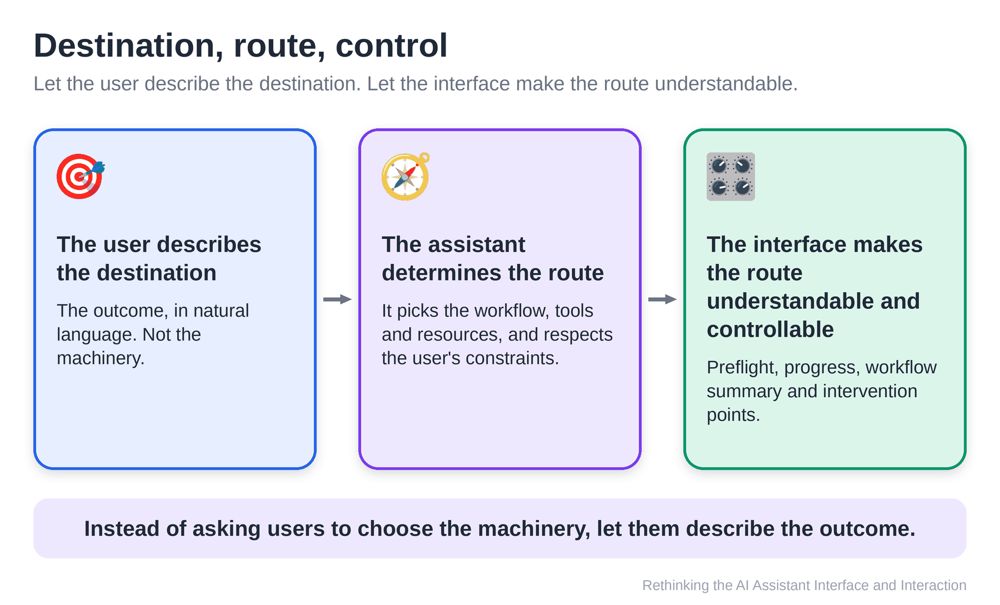

*Figure 23. Destination, route, control.*

## References

**Examples of existing practice (points 11 and 13)**

- [Deep research in ChatGPT (OpenAI Help Center)](https://help.openai.com/en/articles/10500283)
- [Managing app permissions in ChatGPT (OpenAI Help Center)](https://help.openai.com/en/articles/20001495)
- [Admin controls for apps in ChatGPT (OpenAI Help Center)](https://help.openai.com/en/articles/11509118)

**Origin of the ideas**

- [The author’s prompting dialogue with ChatGPT, October 2026 (shared conversation)](https://chatgpt.com/s/t_6ae36bde9c908191870eab3eae8a554a)
- [Earlier discussion of the idea: “Rethinking the ChatGPT “+” Menu” (OpenAI Developer Community)](https://community.openai.com/t/rethinking-the-chatgpt-menu/1409856)

## About this document

**Authorship.** Concept, structure and direction: Rashedul Haque Ronjon.

**Origin.** The ideas grew out of hands-on use of AI assistant apps on Android and the web, and out of an iterative prompting dialogue with ChatGPT in October 2026, in which the author set out the concepts and corrected the drafts (see References). The examples in points 2, 5, 11, 13 and 16 come from observing ChatGPT’s Android and web apps. The proposal is meant to apply to any assistant.

**AI assistance.** ChatGPT was used as a drafting aid in that dialogue. Claude (Anthropic) assisted with generalizing the text, drawing the figures and assembling this document and repository. The author directed the work and is responsible for its content.

**Independence.** This is an independent community proposal. It is not affiliated with or endorsed by OpenAI, Anthropic or any other company, and product names are trademarks of their owners. The figures are schematic wireframes drawn for this proposal; they illustrate concepts and are not official screenshots. Emoji in the figures are Noto Emoji by Google (Apache License 2.0).

**License.** Text and figures are licensed under CC BY 4.0. You may share and adapt them with attribution.

**Suggested citation.** Rashedul Haque Ronjon (2026). *Rethinking the AI Assistant Interface and Interaction: From Capability Selection to Intent-Driven AI Orchestration*. GitHub repository.
